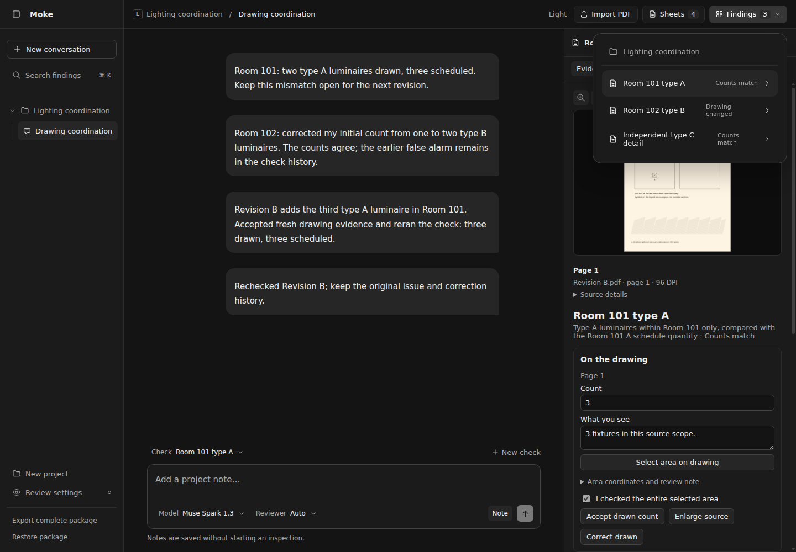
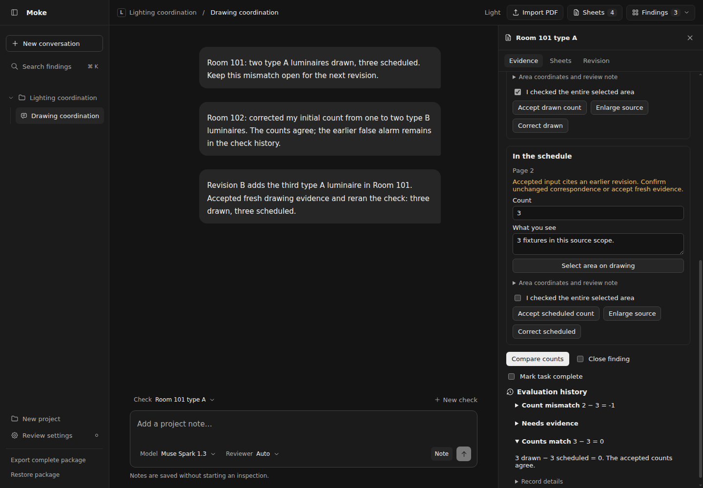

# Moke

Moke is a desktop workbench for reviewing engineering drawing packets, built for
the Meta AI Developer Hackathon. Import the drawings and ask for a whole-set QA
pass or a discipline review. Moke reads source images, follows its review
instructions, records findings and coverage, and produces an offline HTML report.
Follow-up requests can deepen the review while retaining earlier issue IDs.



## The review workflow

1. **Import the packet.** Create a project and import its PDFs. Start a review
   without creating a count check or manually confirming every sheet first.
2. **Ask for the review.** For example, ask "Please run a quick QA pass on this
   drawing set" or "Review the electrical design and supporting calculations."
   Choose a model and reviewer, or let Auto route the request. A saved note does
   not start inference.
3. **Follow the inspection.** Moke inventories the supplied sheets, opens source
   images and detail crops, and records the four review passes: document
   completeness, code and agency requirements, coordination, and prior comments.
   Public-source lookup, repeatable arithmetic and optional SAM segmentation
   support the inspection.
4. **Review the findings and gaps.** Each issue identifies its location, evidence,
   correction and supporting sources or calculations. Unreviewed sheets,
   inaccessible governing text and missing project inputs remain visible. Ask
   follow-up questions in the same conversation.
5. **Export the report.** The self-contained HTML includes findings, embedded
   evidence, coverage, citation status, calculations and prior-comment tracking.
   Its Completed checkboxes track the user's corrections separately from finding
   status and reviewer-verified closure. Export a complete package to preserve
   the source files and execution history as well.

Drawn-to-schedule count comparisons remain available as specialized checks.
Reviewers accept their count inputs and coverage before deterministic comparison;
corrections and revision rechecks retain their history. The
[two-sheet count demonstration](docs/fixtures/hero-case.md) exercises a supported
issue, corrected false alarm, unchanged control and revision recheck.



A review report states what was actually inspected. Model findings are review
results, and a finished execution does not provide professional approval.
Regulatory findings need applicable governing sources; unavailable sources and
unknown editions remain Needs input. SAM geometry does not establish physical
dimensions.

## How it works

| Process            | Owns                                                                                           |
| ------------------ | ---------------------------------------------------------------------------------------------- |
| SvelteKit renderer | Projects, conversations, findings, and source inspection                                       |
| Electron           | Windows, menus, file dialogs, protected credentials, and the trusted renderer bridge           |
| Bun backend        | Effect application services, SQLite, PDF workers, evidence, calculations, and review execution |

Effect Schema contracts validate process messages. The renderer uses Effect RPC
over authorized Electron MessagePorts; Electron forwards application requests to
Bun over authenticated loopback HTTP. Database access and provider credentials
stay outside the renderer.

Pi Durable journals the review and runs the full Moke system instructions. A
separate ledger records model and SAM intent before dispatch, preserving unknown
outcomes without automatic resends. Reviews have pause and cancel controls and an
optional call budget. The default packet review has no application call ceiling;
long conversations use Pi compaction. Complete packages export and restore the
database, original PDFs, rendered evidence and execution journals together.

Projects run locally, but inference uses hosted Meta or Baseten APIs and sends
selected drawing evidence to the provider. Modal checkpoint handoff remains
planned. See [the runtime decision](docs/review-runtime.md) and
[data and recovery](docs/data.md).

## Development

Install the Bun version pinned in [.bun-version](.bun-version), then run:

```sh
bun install --frozen-lockfile
bun run dev
```

You can import drawings and use manual count checks without provider keys.
For model review, copy [.env.example](.env.example) to `.env` and set
`MODEL_API_KEY`, `BASETEN_API_KEY`, or both. Development loads both configured
providers; choose Muse Spark, Muse Wonder or Baseten Muse Spark Open in the app.
Restart after changing credentials. See [inference setup](docs/inference.md) for
packaged-app credentials, model capabilities and optional review budgets.

Bun runs tools and the application backend. The packaged app includes the Bun
executable, PDF renderer, and native assets; users do not install Bun or Node.
Build installers with `bun run package:desktop`. See [desktop builds and releases](docs/deployment.md).

## Verification

```sh
bun run verify          # checks, smoke tests, builds, and Electron end-to-end tests
bun run test:packaged   # after packaging, repeat the desktop flow against the packaged executable
bun run test:screenshots
```

Tests use real local databases, RPC, PDF workers, and Electron. Hosted-provider
boundaries use local transports; normal verification requires no keys and makes
no paid requests. Headless Linux needs an X display, for example
`xvfb-run -a bun run verify`. Install Poppler for the optional experiment smoke
tests; they skip explicitly when `pdftoppm` is unavailable.

Screenshots come from the same Electron workflow using authored synthetic PDFs,
without inference. [Development and testing](docs/development.md) explains the
suite layout, screenshot refresh, and toolchain.

## Repository layout

```text
src/          SvelteKit workbench and shared Effect Schema/RPC contracts
desktop/     Electron shell, preload, and backend connection
backend/      Application services, PDF workers, inference, and review storage
migrations/   Immutable SQLite migrations
tests/       Smoke tests, Electron end-to-end flows, and synthetic fixtures
scripts/      Development, build, packaged checks, and opt-in model experiments
docs/        Setup, architecture, screenshots, and validation evidence
design/       Selected Nightdesk design provenance and the original UI study
experiments/  SAM recipes, captured proposals, and research evidence
```

The [documentation index](docs/README.md) separates setup and architecture from
hackathon research and drawing experiments. The original [UI study](design/concepts/DESIGN.md)
records the Nightdesk reference and third-party asset attribution.

## Hackathon provenance

The Moke name and review prompts predate this entry. This repository implements
a fresh application from the project-kit desktop starter, with drawing evidence,
corrections, and revision tracking built for the hackathon. It does not reuse the
earlier Moke application. Prompt and dependency provenance live in
[the project manifest](.project-kit/manifest.json) and
[the review prompt sources](backend/review/prompts/README.md).
