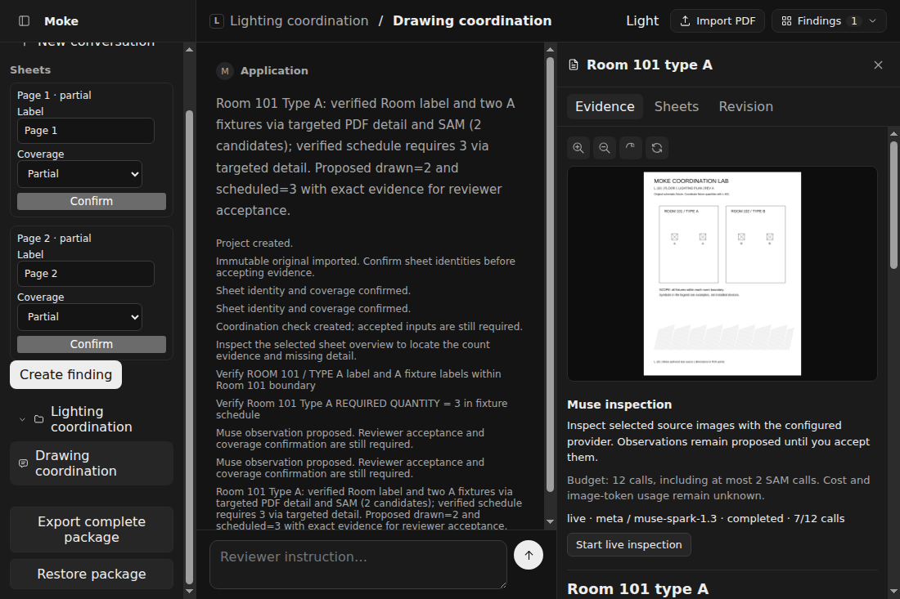

# Local core validation

Observed on Linux x64 / WSL2 with Bun 1.4.4 and Electron 44.7.2, 2026-10-28 UTC.
The primary route is Meta Responses, `muse-spark-1.3`. SAM uses its separate
`sam-3.1` adapter. Modal remains deferred; no cloud deployment was made.

## Packaged acceptance

`MOKE_E2E_LIVE=1 MOKE_SESSION_CREDENTIAL_FILE=/private/session.json DISPLAY=:0
bun run test:packaged` passed both desktop tests. The production flow took
41.8 seconds. Electron loaded the explicit session credential and passed it to
the compiled Bun backend through its private stdin channel. The installed app
used its bundled PDF worker, native canvas addon, PDF.js assets and migrations.

The fresh project imported the original two-sheet fixture, confirmed sheets,
and started one explicitly budgeted inspection. Six Muse calls and one SAM
call completed within the 12-call limit. Muse requested two original-PDF
regions, used SAM geometry, and proposed drawn **2** and scheduled **3** with
source regions and committed response provenance. The engineer then accepted
the inputs; the deterministic check returned **2 − 3 = −1**, supported issue.

| Case                       | Observed result                                                                                                                          |
| -------------------------- | ---------------------------------------------------------------------------------------------------------------------------------------- |
| Room 101 supported issue   | Accepted 2 drawn / 3 scheduled; supported issue retained in history.                                                                     |
| Room 102 false alarm       | Initial accepted 1 / 2 was corrected to 2 / 2; both calculations retained.                                                               |
| Independent type C control | 2 / 2; check ID stayed unchanged through correction and revision.                                                                        |
| Revision B                 | Confirmed changed plan and unchanged schedule; old facts first yielded needs-evidence; fresh accepted 3 yielded 3 / 3, checked-no-issue. |

The same Electron test delivered a PNG larger than 64 KiB through both RPC hops,
exercised zoom/rotation, exported a complete package including its closed Pi
journal, restarted the installed app, and confirmed source/check history survived.
The restored-package API and interrupted replacement boundaries are exercised
separately through real SQLite and the backend RPC.

[Machine-readable evidence](core-validation-result.json) contains actual
response IDs, provider-reported usage, source hashes, package hashes, proposal
provenance and six immutable calculation outcomes. Aggregate reported usage was
74,326 tokens across the 6 Muse receipts: 57,333 input, 2,619 output and
14,374 cache-read tokens. These are provider categories, without a separate
image-token allocation. **Image tokens and verified cost remain unknown.** SDK
catalog price estimates are excluded from the evidence summary and public status.
SAM usage and cost are also unknown.

The retained local evidence is under `.local/core-validation/packaged-2026-10-28-r2/`:
the exported package, receipts and the closed test data. The actual
image files are `packaged-live-muse.png` and `review-workbench.png`. They contain
only the authored schematic. This directory and credentials are excluded from git.

## Repeatable checks

- `bun run verify`: strict TypeScript and Effect diagnostics, Svelte checks,
  vendored lint, formatting, network-free tests, all builds, and Electron E2E.
- `tests/pi-storage.test.ts`: all 25 published storage conformance cases plus
  rollback/transaction-lifecycle cases: 27 tests, 210 assertions.
- `tests/review-execution.test.ts`: actual Pi and SDK with controlled SSE;
  compiled SIGKILL/ownership recovery, zero additional sends after uncertainty,
  pause/cancel, command/response receipts, image blocks, bounded image windows,
  journal incompatibility and persisted progress pagination.
- `tests/review-fences.test.ts`: the real parent port and SQLite permit correction
  while a response waits, reject its stale promotion and replay a committed receipt.
- `tests/backend.test.ts`: auth/origin/process failures plus streaming HTTP
  delivery before a subscription closes.
- `tests/documents.test.ts`: actual marked pixels across all page rotations,
  nonzero boxes and UserUnit, bounded artifacts and cancellation.
- `tests/review-segmentation.test.ts`: official parser, coordinate conventions,
  safe SAM receipts, uncertainty and cross-project/version fences.
- `tests/review-packages.test.ts`: complete export/restore, corruption and
  migration rejection, retained snapshots and interrupted replacement recovery.
- `bun run probe:pdf-packaging`: compiled renderer from an isolated sidecar
  layout, without runtime package resolution. Latest probe: exit 0, 512 × 663
  PNG, 2,988 bytes, 204 ms. This is a small packaging fixture, not a drawing benchmark.
- `bun run package:desktop` builds AppImage and Debian installers. The installed
  executable is used by `bun run test:packaged`. Windows/macOS remain in CI;
  their native packaging is not inferred from this Linux run.

## Failures retained and practical limits

The first installed launch exposed unresolved `#lib` aliases in Electron's
external-package bundle; shared shell contracts now bundle through relative
imports. An early live inspection completed SAM but filled the image request
window with repeated crops. Its next intent stopped at `sent=0`; no request was
reissued. That ledger remains under `.local/core-validation/packaged-first-live/`.
The adapter now includes the newest pixels fitting six images / 2 MiB, explicitly
marks omitted older images, and retains all artifact metadata. A regression test
exercises eight image blocks and deterministic receipt replay.

The live test also exposed buffered JSON holding open progress subscriptions.
The Bun-to-Electron hop now uses framed NDJSON, with a regression test through
HTTP. The renderer MessagePort uses the same restricted review schema.

An earlier explicit Baseten probe against `meta-models/muse-spark-open-1026`
completed five calls and proposed 2 / 3, but did not request a targeted crop.
It is retained as a failed secondary-route gate, with no silent fallback or claim
that Baseten passed the same acceptance. Meta is the validated primary route.

The evaluated core sample is **three authored schematic instances**, across two
revisions, rather than the target 12–20 held-out professional instances. No
precision/recall or broad engineering accuracy claim follows from this sample.
The deliberate false alarm tests correction behavior. The separate merged SAM
study records professional-drawing experiments and failures; those are not
silently counted as core held-out evaluations. Private drawings stay outside git
and packages distributed from this repository.

SAM parser 0.1.0 omits declared source `w`/`h` from its public records. Returned
geometry is checked against delivered dimensions; independent declaration
comparison is unavailable without parsing tokens outside the official API.
Masks are geometry proposals, never physical dimensions or proof of coverage.
Provider retrieval and guaranteed remote cancellation are unavailable here;
unknown outcomes remain explicit, with no automatic resend. A recorded possible-
charge acknowledgement permits only a separate new run and budget.

The council-fix rerun also passed all four hero outcomes. Its revision needs-evidence
row cites only the still-current schedule operand; the rejected baseline plan
operand is null. Full verification passed 198 tests and 1,309 assertions before
that live rerun. See [the council ledger](core-council.md) for recovery and history fixes.
